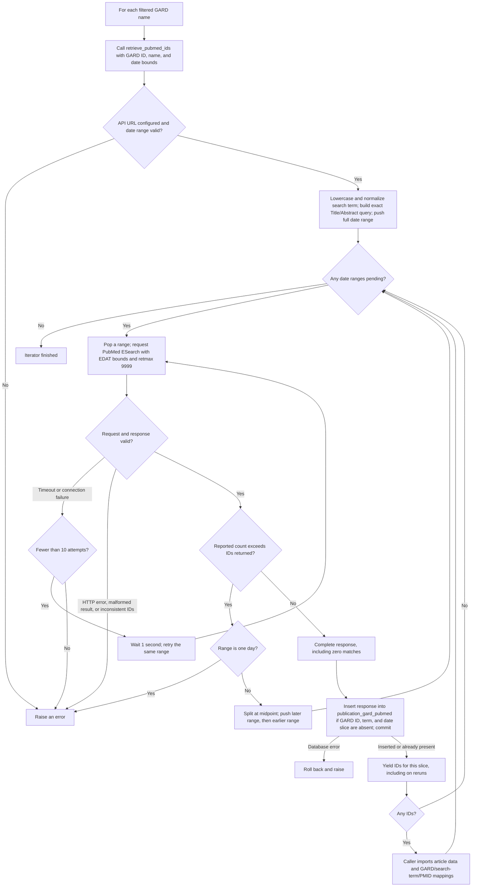

# PubMed ID retrieval workflow

This diagram describes `NewPublicationDiscoveryTask.retrieve_pubmed_ids()` in
[`task_publication_1.py`](./task_publication_1.py). For each filtered GARD disease
name, `find_new_data()` passes the GARD ID, name, last update date, and today's
date to this method. The method yields one complete PubMed ID list at a time;
the caller then passes each nonempty list to `find_new_publications()`.

## Why date splitting is necessary

PubMed's `count` is the total number of matches, while `idlist` contains only
the IDs returned by the request. The method requests at most 9,999 IDs. For
example, a `GARD:0000016` search for `coma` reported 41,918 matches but returned
9,999 IDs for the original date range. That response is **not** stored or yielded.
The method splits the inclusive EDAT range into two nonoverlapping ranges and
keeps splitting until every saved slice has `count == len(idlist)`. The stack
processes earlier dates first.

Each complete response is stored with its exact `year_range`, lowercased
`search_term`, reported count, returned IDs, query translation, warnings, and
raw JSON. An existing row skips the insert, but its IDs are yielded again so a
rerun can finish article and mapping imports. A truncated single-day response
raises an error because splitting by date cannot recover its missing IDs.
