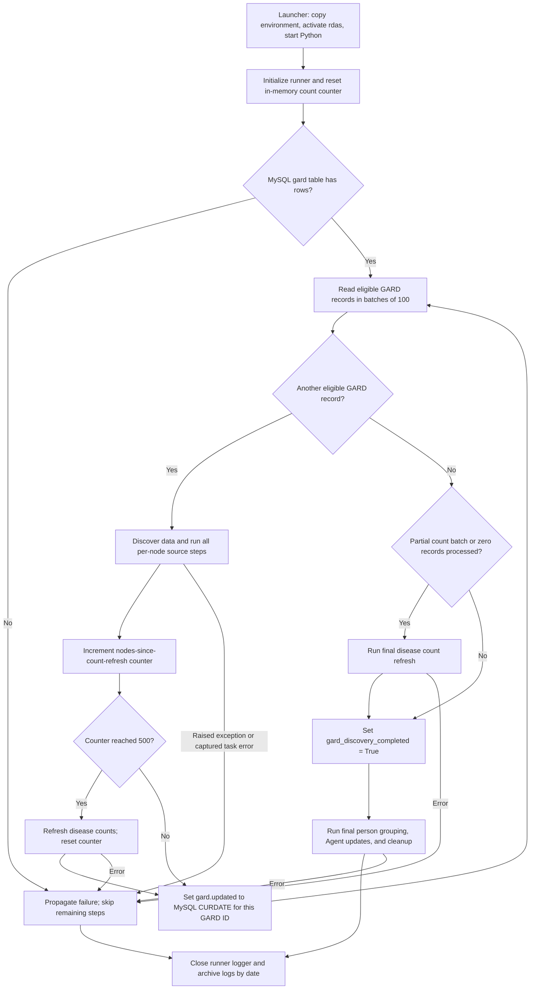
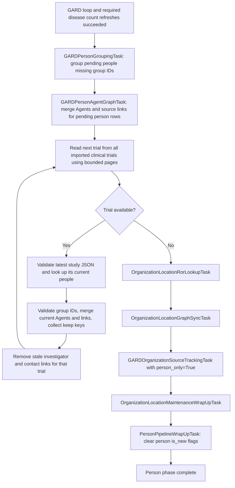

# GARD main pipeline workflow

This document describes [`pipeline_2_process_gard_nodes.py`](./pipeline_2_process_gard_nodes.py)
and its `GARDToMySQLAndMemgraphUpdateRunner`. It performs the one-time clinical-trial
and publication build for GARD diseases, reusing the tasks in
[`AlertPipelineRunner`](../../Z_Alert/main.py). Later incremental updates belong to
the regular Alert pipelines.

The runner processes GARD records sequentially. It finishes each record's source
updates and person extraction before continuing. Person grouping, Agent graph
updates, and person flag cleanup run after the complete GARD loop.

## Entry point

Run from this directory:

```bash
./sh_pipeline_2_run.sh
```

The launcher copies the project-root `.env.newdb` to `.env`, activates the `rdas`
conda environment, and starts the Python runner. The configured databases must
already contain the GARD source data and initial graph data from
`Z_GARD_Update/1_GARD_DBs_update`; an empty MySQL `gard` table stops this runner.
Memgraph index initialization is handled separately by pipeline 1 in this directory.

## Overall workflow



`GardNodeNamesTask.get_gard_nodes()` is called with
`mark_updated_before_yield=False` and `only_unprocessed=True`. It selects rows
whose `updated IS NULL`, applies its label filters, and prepares `filtered_names`.
The query groups by GARD ID, MONDO ID, and label source, so a batch can contain
more than one record for the same GARD ID. The checkpoint updates all source rows
for that ID.

The diagram's fetch step consumes the current batch before requesting another.
The count threshold measures iterations in the current Python run; the counter
starts again after a restart. A run ending exactly on a successful 500-record
refresh does not need an additional final refresh.

## Work performed for each GARD record

Discovery receives the record's GARD ID and filtered names with
`updated = '1971-01-01'`. This fixed start date provides the historical search
window for the initial build; it is separate from the `gard.updated` completion
checkpoint.

| Order | Method or task | Work performed |
| --- | --- | --- |
| 1 | `NewClinicalTrialDiscoveryTask.find_new_data()` | Discover clinical trials for the filtered disease names. |
| 2 | `NewPublicationDiscoveryTask.find_new_data()` | Discover PubMed IDs and import article/search-term mappings. See the [PubMed retrieval workflow](../../Z_Alert/pipelines/pipeline_3_publication/task_publication_1.md). |
| 3 | `run_omim_updates_for_gard_node(gard_id)` | Stage this GARD ID's OMIM mappings and retrieve missing shared OMIM entries. Repeated visits to the same ID skip this work after its first successful attempt in the current run. |
| 4 | `run_clinical_trial_mysql_updates()` | Import and enrich staged trial data, including drugs, publication mappings, article imports, and annotations. |
| 5 | `run_publication_mysql_updates()` | Classify articles, retrieve PubTator/chemical data, filter false positives, and import OMIM articles. |
| 6 | `run_clinical_trial_graph_updates()` | Update trial nodes and their disease, condition, intervention, drug, participant, outcome, design, annotation, organization, and location data. |
| 7 | `run_publication_graph_updates()` | Update article nodes, publication metadata, disease relationships, and OMIM references. |
| 8 | `run_pipeline_followup_updates()` | Update trial/article relationships, GARD relationship counts, GeneReview flags, and dashboard counts. `DiseaseCountsRefreshTask` is deferred to the 500-record checkpoints. |
| 9 | `run_person_extraction()` | Run publication, clinical-trial, and grant person extraction while source `is_new` flags are still available. New person rows retain `is_new = 1`. |
| 10 | `run_pipeline_maintenance()` | Run organization ROR lookup and graph synchronization; track clinical-trial and project organization sources. Person affiliation tracking is deferred. |
| 11 | `run_pipeline_wrapup()` | Clear consumed clinical-trial, publication, and organization staging flags. Keep person flags pending. |
| 12 | Count checkpoint and GARD checkpoint | Refresh disease counts if the counter reaches 500, then mark this GARD ID's source rows updated. |

Orders 4–11 are the ordered steps inside `run_post_discovery_steps(gard_id)`.
Discovery tasks release their database resources before these longer updates begin.

Downstream shared tasks generally select staged rows using their table's
`is_new` flags. Passing a GARD ID to this runner does not make every downstream
query filter by that ID; per-node wrap-up keeps the staged workload from
accumulating across the entire build. The runner does not launch concurrent GARD
workers. Grant person extraction consumes available grant staging data; the grant
data update pipeline remains a separate entry point. Alert emails are not sent.

## Final person processing

`run_final_person_updates()` requires `gard_discovery_completed = True`.
It also runs when a restart finds no remaining eligible GARD records, allowing an
unfinished person phase to be retried after all source checkpoints were saved.



These GARD-specific tasks are defined in [`gard_person_tasks.py`](./gard_person_tasks.py):

- **Grouping:** discover actual pending surname prefixes in pages of 100,
  including Unicode and one-character names. The inherited grouping logic compares
  all people with each selected surname, preserves existing group IDs, and uses a
  bounded process pool for disambiguation. Workers return update values; the parent
  writes them to MySQL. A single surname's people are still loaded together.
- **Agent creation:** read pending person rows by increasing primary key in pages
  of 500. Reuse the shared Agent payload builders and graph `MERGE` statements.
- **Trial reconciliation:** read `clinical_trial_unique` in pages of 100 regardless
  of its `is_new` flags, which were already cleared per node. Use the latest study
  JSON to identify current people, look up matching person rows regardless of their
  flags, and rebuild the keep lists for one trial at a time.
- **Relationship cleanup:** remove stale `has_investigator` and `has_contact`
  relationships only after that trial's source was validated and current graph
  writes succeeded. A valid empty people list removes old links. Invalid study
  JSON, missing extracted identities, or usable people without group IDs stop
  processing before that trial's cleanup. Shared Agent nodes are not deleted.
- **Affiliation tracking:** process pending person affiliations once in the final
  phase. Per-node source tracking handles only clinical trials and projects.

Any failure stops the remaining final steps. `PersonPipelineWrapUpTask` runs only
after grouping, Agent updates, and organization processing succeed.

## Flags and restart behavior

| State | Meaning | When it changes |
| --- | --- | --- |
| `gard.updated IS NULL` | Source record is eligible for the one-time build, subject to label filters. | Set to MySQL `CURDATE()` after per-node work and any count refresh due at that checkpoint. |
| Clinical-trial/publication `is_new = 1` | Source rows are staged for enrichment, graph updates, and person extraction. | Cleared by per-node source wrap-up. |
| `person_of_all_sources.is_new = 1` | Person work is pending for final grouping, graph updates, and affiliation tracking. | Preserved across GARD checkpoints; cleared by the last final person task. |
| `person_of_all_sources.rdas_group_id` | Persisted person grouping identity. | Assigned during grouping; existing IDs are reused. |
| `gard_discovery_completed` | The current process finished the GARD loop and required count refreshes. | Set in memory only; recomputed on restart. |

A failure before the GARD checkpoint leaves that ID's existing `gard.updated`
values unchanged; source rows still marked NULL remain eligible on restart.
Some earlier task writes may already have committed: this runner does not make
an entire GARD iteration one database transaction. Flags already cleared by a
successful wrap-up are not restored automatically.

If the final person phase fails, completed GARD checkpoints remain saved and
pending person flags remain set. Restarting the runner reaches finalization again;
grouping reuses saved group IDs, and Agent graph writes use `MERGE`. The final
trial pass rebuilds its worklist from all imported trials rather than relying on
clinical-trial staging flags. There is no separate persisted final-phase checkpoint,
so restarting after a successful build still refreshes counts and reconciles trials.

`raise_task_errors = True` stops the GARD runner on raised task errors.
`GARDTaskErrorCheckingMixin` also detects `ERROR` records logged on each wrapped
task's logger, including errors that the task catches internally. Discovery has
equivalent local log handlers. Cleanup closes task resources; the entry point
closes the runner logger and archives logs in its `finally` block.

## Model caches and performance controls

| Mechanism | Behavior |
| --- | --- |
| `GARDModelCachingClinicalTrialAnnotationTask` | Load `en_ner_bionlp13cg_md`, `en_ner_bc5cdr_md`, and their UMLS linkers once after a successful load; reuse them across GARD iterations. |
| `GARDModelCachingPublicationFalsePositiveFilterTask` | Load `en_core_web_sm` once and reuse it across publication filtering tasks. |
| `DISEASE_COUNTS_REFRESH_NODE_BATCH_SIZE = 500` | Defer the full `DiseaseCountsRefreshTask` scan; other follow-up count tasks still run per node. |
| Deferred person phase | Avoid repeated grouping, Agent processing, and scans of the growing pending affiliation backlog per GARD record. |
| `PERSON_GROUPING_MAX_WORKERS` | Optional worker limit honored by the shared grouping task through `_resolve_worker_count()`. GARD source processing remains sequential. |

Model caches live only in the current Python process and are rebuilt after a
restart. Database connections, task loggers, and task instances remain separate
for each task. The GARD runner substitutes these caching and person task classes
locally; the regular Alert runner continues using its shared task classes and
its own scheduling and person-processing order.
