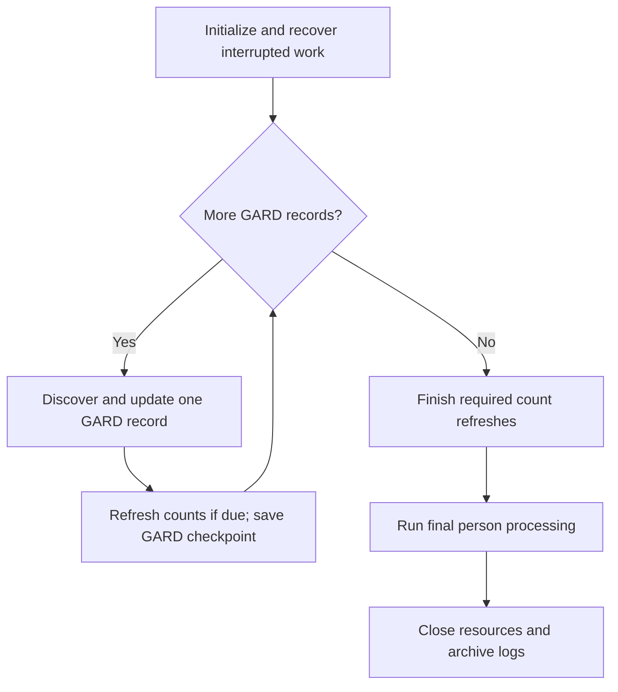
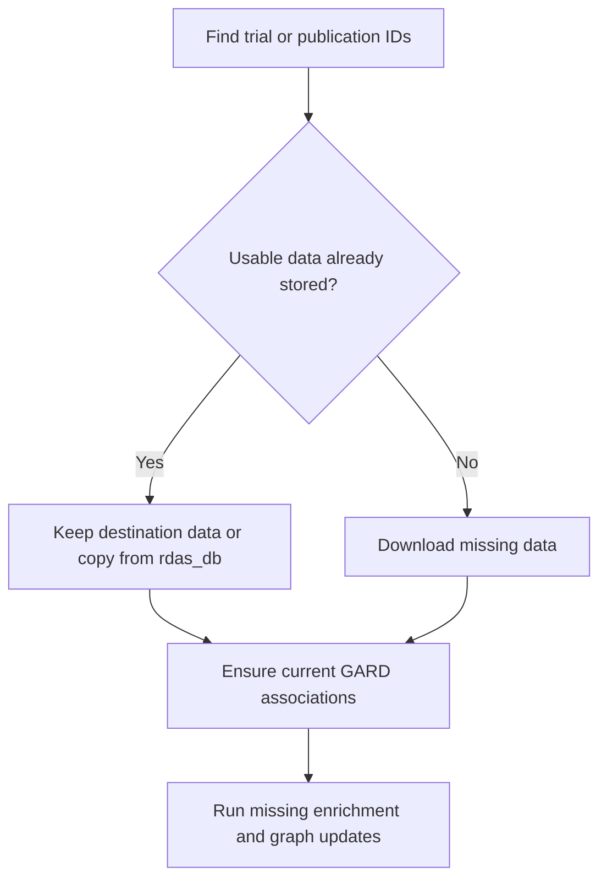
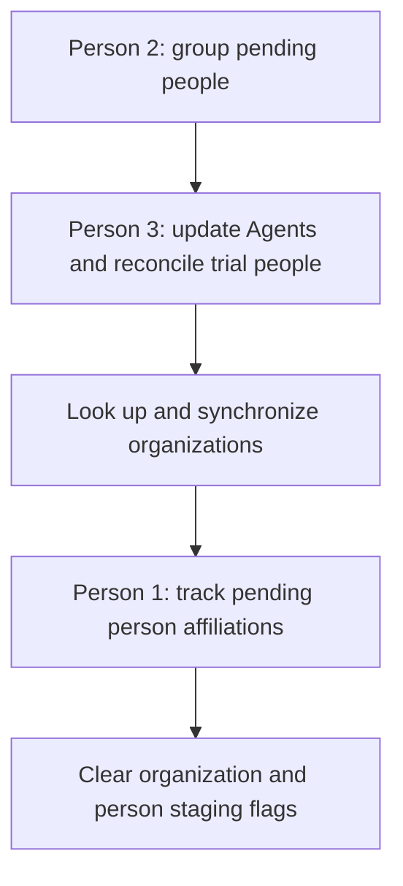

# GARD main pipeline workflow

## Purpose and entry point

[`pipeline_2_process_gard_nodes.py`](./pipeline_2_process_gard_nodes.py) runs
`GARDToMySQLAndMemgraphUpdateRunner`, the one-time clinical-trial and publication
build for the new GARD databases. It reuses
[`AlertPipelineRunner`](../../Z_Alert/main.py) with GARD-specific task substitutions.
The regular Alert pipelines handle subsequent incremental updates.

Run from this directory:

```bash
./sh_pipeline_2_run.sh
```

The launcher copies project-root `.env.newdb` to `.env`, activates the `rdas`
conda environment, and starts the runner. Initial GARD MySQL/graph data must
already be loaded by `Z_GARD_Update/1_GARD_DBs_update`; graph indexes are prepared
separately by pipeline 1 in this directory.

The MySQL connection needs `SELECT` access to `rdas_db` and write access to
`gard_rdas_db` on the same server. The reuse helper validates the selected target
database and source/target writable columns. No additional schema migration is
required for reuse.

## 1. Overall workflow

GARD records run sequentially. Each record finishes its source updates and person
extraction before the next record begins. Person grouping and Agent updates run
once after the full GARD loop.



The diagrams show the successful flow. Raised exceptions or captured task errors
stop remaining work; resource cleanup and log archival still run.

### Selection and checkpoints

`GardNodeNamesTask.get_gard_nodes()` receives
`mark_updated_before_yield=False` and `only_unprocessed=True`. It reads up to 100
records per batch, selects `updated IS NULL`, applies its label filters, and
prepares `filtered_names`. An empty MySQL `gard` table stops the runner.

Each discovery request uses `updated='1971-01-01'` as its historical search start.
This value is separate from the saved `gard.updated` completion checkpoint.
After successful per-record processing and any count refresh due at that point,
the runner sets `gard.updated` to MySQL `CURDATE()` for the current GARD ID.

`DiseaseCountsRefreshTask` runs every **500 completed loop iterations**, with a
final refresh for a partial batch or when no eligible records remain. A run
ending exactly on a successful 500-record refresh needs no extra refresh. The
counter resets on restart. Records are grouped by GARD ID, MONDO ID, and label
source, so iterations are not necessarily unique GARD IDs; one checkpoint updates
all source rows for that ID. Already fetched records in the batch are still consumed.

## 2. Processing one GARD record

The following order spans all task domains. Steps 4–11 run inside
`run_post_discovery_steps(gard_id)`; discovery connections close before those
longer steps begin.

| Order | Method or task | Work performed |
| --- | --- | --- |
| 1 | ClinicalTrial 1 | Search NCT IDs, reuse cached studies, download missing studies, and create current-GARD trial mappings. |
| 2 | Publication 1 | Search complete PMID slices, reuse/import Articles, and create current-GARD/term/PMID mappings. |
| 3 | Publication 2, then Publication 3 | Map current-GARD OMIM cross-references, reuse OMIM entries/reference pairs, and fetch missing entries. Repeated visits to the same GARD ID skip this step after its first success in the current process. |
| 4 | `run_clinical_trial_mysql_updates()` | Import trials, map drug interventions, extract trial/PMID references, run ClinicalTrial 2, then annotate studies with missing NLP results. |
| 5 | `run_publication_mysql_updates()` | Run Publication 4 first, then EPI/NHS classification, PubTator retrieval/parsing, substance extraction, and abbreviation filtering. |
| 6 | `run_clinical_trial_graph_updates()` | Update trial nodes and their GARD, condition, intervention, drug, participant, outcome, design, IPD, annotation, organization, and location data. |
| 7 | `run_publication_graph_updates()` | Update Articles and related graph data, including Publication 5, PubTator/substance data, and OMIMRef nodes. |
| 8 | `run_pipeline_followup_updates()` | Update trial/Article links, GARD relationship counts, GeneReview flags, and dashboard counts; defer the full disease count refresh. |
| 9 | `run_person_extraction()` | Extract publication, clinical-trial, and available grant people. Retain their pending person flags. |
| 10 | `run_pipeline_maintenance()` | Run organization ROR lookup and graph sync, then Person 1 for trial/project organization sources. |
| 11 | `run_pipeline_wrapup()` | Clear clinical-trial, publication, and organization staging flags; keep person flags pending. |
| 12 | Count refresh and GARD checkpoint | Refresh disease counts if due, then save the current GARD ID's completion checkpoint. |

Trial reference Articles enter before publication enrichment through ClinicalTrial 2.
OMIM reference Articles enter at the start of publication enrichment through
Publication 4, so both receive downstream processing in the same iteration.

Shared downstream tasks generally select `is_new` rows rather than filtering
every query by GARD ID. Per-node source wrap-up keeps the staged workload bounded.
This runner does not start concurrent GARD workers, run the grant data update
pipeline, or send alert emails.

## 3. Task modules and numbering

Each GARD-specific task has its own module under [`tasks/`](./tasks/). Filenames
follow `task_<ClinicalTrial|Publication|Person>_<number>_<ClassName>.py`.
**Numbering starts at 1 independently in each domain**, following first invocation
within that domain. Domain numbers are separate from the overall execution order
and the runner's existing log step numbers.

| Domain | Number | Task module | Role |
| --- | --- | --- | --- |
| ClinicalTrial | 1 | [GARDClinicalTrialDiscoveryTask](./tasks/task_ClinicalTrial_1_GARDClinicalTrialDiscoveryTask.py) | Trial discovery and cached study reuse. |
| ClinicalTrial | 2 | [GARDClinicalTrialPmidArticleImportTask](./tasks/task_ClinicalTrial_2_GARDClinicalTrialPmidArticleImportTask.py) | Trial reference Article reuse/import. |
| Publication | 1 | [GARDPublicationDiscoveryTask](./tasks/task_Publication_1_GARDPublicationDiscoveryTask.py) | PubMed discovery and cached Article reuse. |
| Publication | 2 | [GARDOMIMPublicationMappingTask](./tasks/task_Publication_2_GARDOMIMPublicationMappingTask.py) | Current-GARD OMIM mapping. |
| Publication | 3 | [GARDOMIMDataRetrievalTask](./tasks/task_Publication_3_GARDOMIMDataRetrievalTask.py) | Cached OMIM reuse and missing-entry retrieval. |
| Publication | 4 | [GARDOMIMPublicationArticleImportTask](./tasks/task_Publication_4_GARDOMIMPublicationArticleImportTask.py) | OMIM reference Article reuse/import. |
| Publication | 5 | [GARDPublicationGardArticleRelationshipTask](./tasks/task_Publication_5_GARDPublicationGardArticleRelationshipTask.py) | Current-GARD Article graph relationships. |
| Person | 1 | [GARDOrganizationSourceTrackingTask](./tasks/task_Person_1_GARDOrganizationSourceTrackingTask.py) | Trial/project source tracking per node; person affiliations in the final phase. |
| Person | 2 | [GARDPersonGroupingTask](./tasks/task_Person_2_GARDPersonGroupingTask.py) | Final grouping of accumulated pending people. |
| Person | 3 | [GARDPersonAgentGraphTask](./tasks/task_Person_3_GARDPersonAgentGraphTask.py) | Final Agent updates and trial relationship reconciliation. |

[`tasks/gard_existing_data.py`](./tasks/gard_existing_data.py) contains the shared
`GARDExistingDataReuse` helper and has no task number. One helper instance serves
the run; its current GARD ID and enrichment exclusion sets reset per record.
Model caching and error capture classes remain in the runner. Task modules
contain detailed comments and example data.

## 4. Reusing existing data

The helper copies eligible records from `rdas_db` into `gard_rdas_db` in batches
of up to 100 IDs. Existing destination records are retained; missing records use
available source cache data before the shared downloaders run.

No separate cache of copied records is created. Source canonical studies and
current-GARD trial mappings use batched `INSERT ... SELECT` statements inside
MySQL. Substance copies first select the current PMIDs' hashes, then look up
only those hashes through the source index. Copy logs report progress per batch;
trial discovery also separates API search, SQL copy, and download/import time.



### Clinical-trial reuse

| Table | Copy behavior |
| --- | --- |
| `clinical_trial` | Create/reuse the current `gardId`, disease term, and NCT ID mapping with `is_new=1`. |
| `clinical_trial_unique` | Reuse canonical study JSON; an existing valid destination study takes precedence. |
| `clinical_trial_intervention_drug` | Reuse eligible RxNorm rows, rebinding `gardId` and disease to the current search. |
| `clinical_trial_annotation` | Reuse matching study annotations from completed source staging. Without annotation rows or a source completion marker, run NLP. |
| `clinical_trial_nctid_pmids_mapping` | Reuse and stage trial/PMID pairs for Article import and graph relationships. |

### Publication reuse

Nine `rdas_db.publication*` tables are eligible for reuse in their corresponding
destination tables in `gard_rdas_db`. Copies are limited to discovered PMIDs and
current-GARD OMIM associations. `publication_gard_pubmed` is populated only by
the live PubMed searches; historical source search responses are not copied.

| Table | Copy behavior |
| --- | --- |
| `publication_article` | Copy missing metadata, classification, and EPI extraction fields from a source row with valid JSON. Fill missing classification on pending target Articles only when title/abstract match. |
| `publication_pubtator`, `publication_pubtator_parsed` | Copy cached JSON and parsed annotations for matching pending Article content. MySQL computes generated `source_json_len`. |
| `publication_substance`, `publication_substance_unique` | Copy relevant substance rows and their referenced unique records. |
| `publication_gard_searchterm_pubmed_mapping` | Copy exact current-GARD/current-term/PMID tuples; reset copied abbreviation decisions for current validation. Shared discovery creates missing tuples. |
| `publication_gard_pubmed` | No source copy. The inherited live search saves complete responses for the current GARD/term/date slice. Previously copied rows are retained. |
| `publication_gard_omim_mapping` | Copy current-GARD pairs only when the current GARD cross-references still include the OMIM ID; shared mapping adds new pairs. |
| `publication_omim` | Copy valid current-GARD OMIM entries, preserve existing target JSON, and restage relevant entries for PMID import and OMIMRef graph work. |
| `publication_omim_pubmed_mapping` | Copy relevant pairs only when source/destination entry JSON agrees and the PMID occurs in that JSON. Shared parsing fills missing pairs. |

Every copied disease-bearing mapping explicitly uses the **current GARD ID**.
Shared NCT/PMID/OMIM records connect through their association tables; raw JSON is
not rewritten. Trial-only or OMIM-only references do not receive invented direct
search-term mappings. Newly copied rows receive `is_new=1` where supported.
Existing completed Articles stay at `is_new=0`; Publication 5 can still add their
new GARD relationships without repeating author extraction.

Source IDs, creation timestamps, generic `processed` markers, and generated
columns are omitted. Tables without `is_new` retain their existing schema.
Production rows and flags are never changed. Reuse follows stored snapshots and
matching content; live ID searches do not verify that cached full payloads are
the latest API versions.

For example, a completed Article for PMID `9282845` can receive a new mapping to
`GARD:0000016` without being marked new again. A PubMed response reporting 41,918
matches but returning only 9,999 IDs is rejected as incomplete; inherited retrieval
splits the date range into complete slices. See the
[PubMed retrieval workflow](../../Z_Alert/pipelines/pipeline_3_publication/task_publication_1.md).

## 5. Final person processing

This phase starts only when the GARD loop and required count refreshes succeed
and set `gard_discovery_completed=True`. It also runs on a restart with no
remaining eligible GARD records.



| Stage | Detail |
| --- | --- |
| Group people | Discover actual pending surname prefixes in pages of 100, including Unicode and one-character names. Shared disambiguation preserves existing group IDs and performs CPU work in its bounded process pool. |
| Update Agents | Read pending people by primary key in pages of 500 and merge Agents/source links. |
| Reconcile trial people | Read all imported trials in pages of 100, regardless of trial flags. Use latest study JSON and matching grouped people regardless of their person flags; remove stale investigator/contact links only after successful current writes. |
| Track affiliations | Run organization ROR lookup and graph sync, then Person 1 with `person_only=True`. Trial/project source tracking already ran per node. |
| Clear final flags | Run organization wrap-up, then `PersonPipelineWrapUpTask`, only after all preceding stages succeed. |

Invalid study JSON, missing extracted identities, or usable people without group
IDs stop trial reconciliation before that trial's cleanup. A valid empty people
list removes stale links without deleting shared Agent nodes.

## 6. Flags and restart behavior

Here, staging flags belong to destination **`gard_rdas_db`** tables. Production
`rdas_db` flags remain unchanged.

| State | Meaning and lifecycle |
| --- | --- |
| `gard.updated IS NULL` | Eligible for this one-time build. Set to MySQL `CURDATE()` after successful per-record processing and any count refresh due at that checkpoint. |
| Clinical-trial/publication `is_new=1` | Pending enrichment, graph updates, and person extraction. Cleared by per-node source wrap-up. Relevant OMIM rows may be restaged for another GARD association. |
| Clinical-trial `is_new=2` | Temporary exclusion of reused RxNorm/annotation inputs from one enrichment task. Restore to 1 afterward; startup recovery restores interrupted exclusions. |
| `person_of_all_sources.is_new=1` | Pending final person work. Retained across GARD checkpoints and cleared only after final processing succeeds. |
| `person_of_all_sources.rdas_group_id` | Persisted grouping identity reused by grouping and graph retries. |
| `gard_discovery_completed` | In-memory gate for final person processing, recomputed after the loop and required counts finish. |

`enrichment_scope()` changes exact reused input rows from 1 to 2, then restores
them in `finally` before graph/person work. When no missing enrichment remains,
task construction is skipped. Pending Article classification is checked separately.
Startup recovery restores temporary 2 markers, not ordinary completed 0 markers.

A GARD iteration is not one database transaction. Earlier tasks can commit before
a later failure. The current GARD checkpoint remains unchanged on failure, but
already cleared source flags are not automatically restored.

If final person work fails, completed GARD checkpoints remain saved and pending
person flags remain available. Restarting reaches finalization again, reuses
saved groups, and uses graph `MERGE` operations. There is no separate persisted
final-phase checkpoint: restarting a completed build still refreshes counts and
reconciles imported trials.

## 7. Caching, concurrency, and errors

| Mechanism | Behavior |
| --- | --- |
| Clinical-trial model cache | `GARDModelCachingClinicalTrialAnnotationTask` reuses `en_ner_bionlp13cg_md`, `en_ner_bc5cdr_md`, and their UMLS linkers after a successful first load. |
| Publication model cache | `GARDModelCachingPublicationFalsePositiveFilterTask` reuses `en_core_web_sm` across iterations. |
| Missing-record downloads | Bounded thread pools overlap HTTP waits; database writes remain in the parent. Optional limits: `CLINICAL_TRIAL_DOWNLOAD_MAX_WORKERS` and `PUBLICATION_DOWNLOAD_MAX_WORKERS`. |
| Person grouping | Shared bounded process pool handles CPU-heavy disambiguation. `PERSON_GROUPING_MAX_WORKERS` supplies an optional upper limit through `_resolve_worker_count()`. |
| Disease counts | `DISEASE_COUNTS_REFRESH_NODE_BATCH_SIZE=500`; other follow-up count tasks still run per node. |

Model caches live only in the current process. Task instances, database
connections, and loggers retain separate lifecycles. Actual speedup depends on
cache coverage and has not been benchmarked here.

`raise_task_errors=True` propagates raised failures. The GARD error-checking
mixin also raises when a wrapped task logs an `ERROR`, preserving the first
message. Discovery has equivalent local handlers. A captured failure prevents
later processing and checkpointing; the entry point closes the runner and
archives logs in `finally`.
